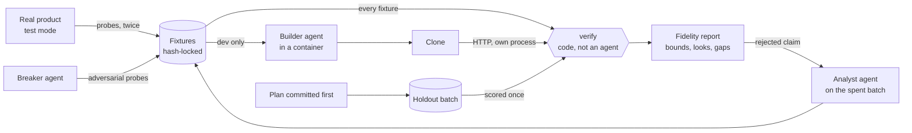
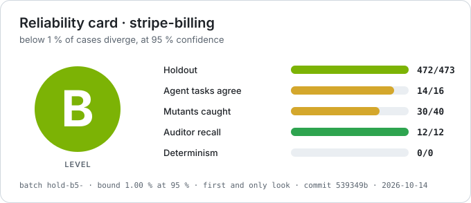

# software-clone-factory

[](https://github.com/thomas-lecocq/software-clone-factory/actions/workflows/ci.yml)

A factory for **verified clones of closed-source software**: resettable, deterministic copies of a
product's behaviour that agents can be trained and evaluated in, with the fidelity of every clone
**measured against the original** rather than asserted.

> Building is the easy part; knowing how much to trust the clone is the hard part.

Agents build, code judges:

- **The truth is recorded.** Designed and random probes are sent to the real product (here, Stripe
  in test mode), each twice to detect noise; the answers are frozen as fixtures, hash-locked.
- **An agent builds the clone** from the development fixtures only, in a sandbox that never holds
  the holdout.
- **A script scores it.** It replays every fixture against a freshly reset clone and compares field
  by field. It reports the clean holdout apart from the rest, with a confidence bound.

The factory knows nothing about any product: a target plugs in through one adapter (its probes, a
way to run a probe on either side, a way to start its clone).

## The workflow



The method is a skill, [`replicate-slice`](.claude/skills/replicate-slice/SKILL.md), that one
session follows step by step: it is the orchestrator. It delegates to agents where a role must stay
independent or isolated, leaves every score to code, and stops at human checkpoints.

| Step                    | Who does it                                      | Held in place by                                                | Human?                       |
| ----------------------- | ------------------------------------------------ | --------------------------------------------------------------- | ---------------------------- |
| 0. Triage               | orchestrator                                     | `docs/target-triage.md`                                         | **chooses target and slice** |
| 1. Recon                | orchestrator                                     | the target's terms (checked)                                    | **terms of service, keys**   |
| 2. Rule ledger          | `recorder` agent                                 | provenance on every rule; status is computed, never stored      | no                           |
| 3. Probe design         | `recorder`, then `breaker` (spec mode)           | the distribution written down; the breaker widens its support   | no                           |
| 4. Adapter and policy   | orchestrator                                     | every weakening of the comparison carries its reason            | no                           |
| 5. Record               | code (`npm run record`)                          | test keys only; each probe twice; hash lock                     | no                           |
| 6. Pre-register a batch | orchestrator                                     | plan and seed committed before recording (the report checks it) | no                           |
| 7. Build                | `builder` agent                                  | container on a copy without holdout; only the clone comes back  | no (budget)                  |
| 8. Break                | `breaker` agent                                  | container on a copy, read-only; its probes stay dev             | no (budget)                  |
| 9. Measure once         | code (`npm run verify`)                          | clone in its own process; every look logged                     | no                           |
| 10. Analyse a rejection | `analyst` agent                                  | a copy holding only the spent batch; only its report comes back | no                           |
| 11. Variance            | `builder`, more builds from scratch              | one worktree each, scored once                                  | **spending**                 |
| 12. Audit               | auditor prompt, measured by planted defects      | a planted copy in the container; only its findings are read     | **adjudicates findings**     |
| 13. Report              | code (fidelity report), orchestrator (`GAPS.md`) | generated sections from the run; declared ones by hand          | **publication**              |

**How autonomous it is.** In this repository's run, the agents and the code did steps 5 and 7 to
13 on their own; the maintainer only made the decisions marked human. Two departures from the
table: the rules and probes (steps 2 and 3) were written by the orchestrator directly, not by the
`recorder` agent, and the breaker's spec mode was added to the method after the run, so it has not
run yet. The orchestrator was a Claude Code session working with the maintainer, and several of its
decisions (the distribution, batch sizes, when to call the analyst) were made by judgement before
being written into the skill. So the claim is "a method that automates most of the work, written
down"; a fresh session running it end to end on a new target is the
[roadmap](docs/roadmap.md)'s first item.

**What each run costs** is logged in each target's `timings.jsonl`: here a build from scratch took
1 to 1.7 hours and $16 to $23 (API-equivalent, Opus 5.5), a breaker round $2, an audit $3 to $5,
recording a 473-case batch about 1.5 hours and nothing (test mode), and `verify` about 7 minutes.

## How a clone is checked

| Layer       | What is compared                                                                     | Decides the verdict |
| ----------- | ------------------------------------------------------------------------------------ | ------------------- |
| API         | every field of every response, generated IDs compared by the references between them | yes                 |
| Screens     | the accessibility tree of each screen a scripted walkthrough reaches                 | yes                 |
| Calls       | the body and status of each call a screen fires                                      | yes                 |
| Effect      | the account state a UI flow leaves behind, read through the public API               | yes                 |
| State graph | every screen reachable by clicking, breadth first, and every transition between them | yes                 |
| Layout      | the box of each visible element, within a tolerance the diff policy states           | yes                 |
| Pixels      | a masked grey thumbnail                                                              | reported only       |

Each run writes a **fidelity report** (`verify/fidelity-report.md`): scope, clean measurement,
confidence bound, coverage, determinism, divergences, saturation, task validation, integrity. The
headline number comes from a holdout batch whose size, distribution and decision rule were
committed before it was recorded (`analysis-plan.md`), and which is scored once.

The auditors are measured too: `audit/meta.ts` plants known defects in a copy of the repository,
runs the committed auditor prompt on it, and reports the share it found. The defect library stays
out of every copy an auditor or a builder sees.

## First target: Stripe Billing

- **Slice 1:** a mid-cycle plan change (proration, rounding, coupons, billing modes), through the
  invoice preview API and the Customer Portal screens.
- **Slice 2:** cancel and renew in the portal, and the subscription lifecycle over test clocks.

## Results

All numbers come from `npm run verify` and are logged in
[`targets/stripe-billing/measurements.md`](targets/stripe-billing/measurements.md); what they do
not cover is in [`GAPS.md`](targets/stripe-billing/GAPS.md).

**The claims.** In Stripe **test mode**, on slice 1 (a mid-cycle change previewed with
`invoices.createPreview`, at any second of the period), each on a holdout batch whose size,
distribution and decision rule were committed before it was recorded, scored once:

- on the first distribution (1 to 3 items, monthly or yearly, 0 to 2 coupons, quantities 1 to
  10), the clone diverges on **fewer than 1 % of cases, at 99 % confidence** (473 of 473);
- on the wider one (up to 4 items, amounts from 50 cents to $100,000, 100 % coupons, quantity
  0), the latest clone diverges on **fewer than 1 % of cases, at 99 % confidence** (473 of 473,
  on a batch scored in three stages), after two clones that reached only 95 % (472 of 473 each).

**How it got there, failures included.**

| Step                                                                                                 | Result                                               |
| ---------------------------------------------------------------------------------------------------- | ---------------------------------------------------- |
| Builder agent, from an empty server, in the container                                                | 379 of 387 dev (logged on the host), 1 h, about $16  |
| Pre-registered batch 1, single look                                                                  | **448 of 473: claim rejected**                       |
| Analysis of the 25 failures by a separate session                                                    | six root causes, mostly discounts                    |
| 379 new dev probes, one more builder pass (32 min, $7)                                               | 696 of 696 dev                                       |
| Pre-registered batch 2 (new seed), single look                                                       | **473 of 473: claim holds**                          |
| Breaker round, 306 new dev probes on a wider distribution, one more builder pass (30 min, $4.50)     | 976 of 976 dev                                       |
| Pre-registered batch 3, on the wider distribution, single look                                       | **466 of 473: claim rejected** (below 2.8 % at 95 %) |
| Analysis of batch 3, agent-trace and mutation-hole probes, one more builder pass (40 min, $4.86)     | 1013 of 1013 dev                                     |
| Pre-registered batch 4 (new seed, three stages), scored sequentially                                 | **472 of 473: below 1 % at 95 %**                    |
| v4 dev probes from task validation and mutation testing, one more builder pass (35 min, $5.44)       | 1029 of 1029 dev                                     |
| Pre-registered batch 5 (new seed, three stages), scored sequentially                                 | **472 of 473: below 1 % at 95 %**                    |
| Analysis of batch 4, 167 dev probes on the failing area and the holes, one more pass (28 min, $4.67) | 1196 of 1196 dev                                     |
| Pre-registered batch 6 (new seed, three stages), scored sequentially                                 | **473 of 473: below 1 % at 99 %**                    |

**The wider distribution is harder.** Batch 3 draws from a distribution widened where the breaker
found failures: the improved clone fails 7 of 473, all in classic billing mode. A separate session
analysed the spent batch; its findings became dev probes, the next clone was measured on a fresh
batch 4, and fails 1 of 473; the clone after it fails 1 of 473 on a fresh batch 5. Those
failures were all changes to one of several items under several discounts. An analyst explained
batch 4's; 150 dev cases drawn from that area and the analyst's seven designs went to the
builder, and the next clone passes all 473 cases of a fresh batch 6: below 1 % at 99 % on the
wider distribution. Batches 4 to 6 were split into three stages, each scored only while the
failures stayed within the plan's tolerance, so a clone that fails early spends one stage, not the
whole batch.

**What the claims do not say.**

- A quarter of batch 2 is easy (Stripe errors, changes that change nothing). On the 343
  substantive cases the bound is 0.87 % at 95 % and 1.33 % at 99 %: "below 1 %" holds at 95 % only.
- It is in-distribution. A breaker agent then chose 40 inputs to make the clone fail (100 %
  coupons, quantity 0, very large amounts, several items changing interval): the clone fails **12
  of 40**.
- It is about this clone. Two more builds from scratch, with the same inputs, score 472 of 473 each on
  batch 2, failing different cases ([`variance.md`](targets/stripe-billing/variance.md)): the 99 %
  result is the best build's, not every build's.
- It is test mode only, USD only, and none of the factory's components was ablated.

**An agent was given real tasks.** Eight everyday billing tasks, twice each, against the clone and
against Stripe test mode, with every call logged: the agent succeeds 16 times in 16 on Stripe. On
the clone it went from 10 in 16 to 14, then 16, as each round's failures (calls no fixture
exercised, such as changing a subscription's items or expanding a discount's coupon) became dev
probes. Fidelity on the measured slice does not make a clone a good environment for the calls an
agent actually makes; the factory measures both.

**The auditors were measured, then used.** On copies of the repository with 12 planted defects,
the committed auditor prompt found 12 of 12 (recall at least 77.9 % at 95 %). Two more runs on the
clean repository found 20 real problems, all fixed, among them: the clone ran inside the scorer's
process, could read the recorded fixtures, and could fake its layout from its own page code. Today
it runs in its own process under Node's permission model, and layout is measured in an isolated
world.

Not affiliated with Stripe. The clone reimplements observed behaviour of the public API in test
mode; it contains no Stripe code, and no documentation text beyond short quotes.

### Reliability card

Every holdout run writes one, as Markdown and as an image
([`verify/reliability-card.md`](targets/stripe-billing/verify/reliability-card.md)): its level comes
from a pre-registered batch only, and every figure from a run or a measurement file. Today's, on the
wider distribution:



|                      |                                                                                                                                                                               |
| -------------------- | ----------------------------------------------------------------------------------------------------------------------------------------------------------------------------- |
| **Level**            | **A**: below 1 % of cases diverge, at 99 % confidence                                                                                                                         |
| **Measured on**      | batch `hold-b6-`, 473 of 473; plan `analysis-plan-b6.md`, committed first; 4 looks, its claim rests on the first (`measurements.md`)                                          |
| **Bound**            | 0.63 % at 95 %, 0.97 % at 99 %                                                                                                                                                |
| **Breaker probes**   | 40 of 40 pass; they are dev cases the builder may have learnt, so only a new breaker round tests the clone out of distribution                                                |
| **Dev (training)**   | 1258 of 1265                                                                                                                                                                  |
| **Determinism**      | 10 of 10 replays identical after reset                                                                                                                                        |
| **Mutation testing** | 34 of 40 planted bugs caught by the fixtures (run 2026-10-14)                                                                                                                 |
| **Auditors**         | found 12 of 12 planted defects                                                                                                                                                |
| **Agent tasks**      | an agent (claude-sonnet-5-5) gets the same outcome on the clone as on the original in 16 of 16 task runs; it succeeds in 16 on the clone, 16 on the original (run 2026-10-14) |
| **Evaluator**        | lock `7b6b53fcd9ac`, commit b7c81a3, clean tree                                                                                                                               |

## Run it

Node 24 or later (native TypeScript and the permission model run the clone; tested on 24 and 26).

```bash
npm install && npx playwright install chromium
npm run verify stripe-billing -- --split all   # replay every recorded fixture against the clone
npm run demo                                   # start the clone and print a portal URL to open
```

`verify` needs no Stripe account: the fixtures are Stripe's recorded behaviour. Its exit code is 0
only when every fixture passes. To record new fixtures, copy `.env.example` to `.env` and set a
Stripe **test-mode** key; recording refuses any other kind of key.

| Command                                                                  | What it does                                                                                                   |
| ------------------------------------------------------------------------ | -------------------------------------------------------------------------------------------------------------- |
| `npm run record stripe-billing`                                          | record the probes that have no fixture yet                                                                     |
| `npm run clone stripe-billing`                                           | serve the clone on `http://127.0.0.1:4599`; `POST /__reset` restores the seed                                  |
| `npm run verify stripe-billing -- --sequential hold-b4 --max-failures 1` | score a staged batch stage by stage, stopping early on failure; unscored stages stay fresh                     |
| `npm run check`                                                          | types, lint, format, tests                                                                                     |
| `harness/run-builder.sh stripe-billing`                                  | run the builder agent in the agent container, on a sandbox without the holdout (needs Docker and `.agent.env`) |
| `harness/run-agent.sh breaker stripe-billing "…"`                        | run a breaker round in the agent container; its answer is the proposed probes                                  |
| `npx tsx audit/meta.ts`                                                  | measure the auditor: plant defects in copies, run it, report recall                                            |
| `npx tsx audit/mutate.ts stripe-billing`                                 | plant one-line bugs in the clone and count how many the fixtures catch                                         |
| `harness/run-analyst.sh stripe-billing hold`                             | analyse a spent batch's failures in the agent container; only that batch goes in                               |
| `npx tsx harness/src/replay.ts stripe-billing <fixtures>`                | replay chosen fixtures and print every difference, writing nothing (`--clone <dir>` for a patched copy)        |
| `npm run new-slice <name>`                                               | scaffold a new target                                                                                          |
| `git config core.hooksPath .githooks`                                    | pre-commit check (check plus evaluator lock)                                                                   |

## Layout

| Where                                                | What                                                                                                        |
| ---------------------------------------------------- | ----------------------------------------------------------------------------------------------------------- |
| [`docs/verification.md`](docs/verification.md)       | what "verified" means: the five rules, measurement, process                                                 |
| [`docs/design.md`](docs/design.md)                   | why the factory is built this way, and what was rejected                                                    |
| [`docs/target-triage.md`](docs/target-triage.md)     | how a target is classified by recording mode before any work                                                |
| [`docs/lessons.md`](docs/lessons.md)                 | what went wrong so far, and the rule it gave                                                                |
| [`docs/roadmap.md`](docs/roadmap.md)                 | what could come next, with why and roughly what it costs                                                    |
| [`audit/`](audit/)                                   | the auditor prompt, the planted-defect library and the script that measures auditors                        |
| [`.claude/`](.claude/)                               | the method as a skill (`replicate-slice`), the agents (recorder, builder, breaker, analyst), the guard hook |
| [`harness/`](harness/)                               | recorder, verifier, evaluator lock, diff policy, clone kit, sandbox runners                                 |
| [`targets/stripe-billing/`](targets/stripe-billing/) | recon, rule ledger, probes, recorded fixtures, the clone, gaps                                              |

## License

MIT.
